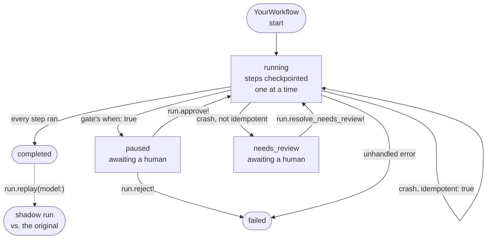

# Belay

Durable execution for AI agents in Rails.

Sidekiq gives you durable background jobs. Belay gives you durable *AI* jobs — every model call and tool call is a database row, so a run can crash at step 47 and resume at step 47.

It sits under whatever prompting style you use and records everything. It is not a prompt library, not a chain-builder DSL, and not a wrapper that hides your LLM SDK.

**Status:** pre-release (`v0.1.0.pre1`). Core runtime, gates & approvals, replay, caching & rules, and the dashboard are implemented and proven with real process kills and real concurrent workers, not just designed - see [DESIGN_DECISIONS.md #13](DESIGN_DECISIONS.md).

## How it works



Every box is a real `run.status`; every arrow is a real method on `Belay::Run` (or the crash-recovery policy a step's own `idempotent:` declares). This is the run-level picture - each individual step is its own checkpointed database row underneath it.

## Installation

```ruby
# Gemfile
gem "belay"
```

```sh
bundle install
rails generate belay:install
rails db:migrate
```

Requires Ruby 3.2+, Rails 7.1+, and Postgres. See [DESIGN_DECISIONS.md](DESIGN_DECISIONS.md) for why.

## Configuration

```ruby
# config/initializers/belay.rb
Belay.configure do |config|
  config.provider = Belay::AnthropicProvider.new # the provider ctx.llm calls - see docs/providers.md
  config.lease_duration = 300          # seconds a worker holds a run before the janitor reclaims it
  config.heartbeat_interval = 30       # seconds between heartbeats while a step is in flight
  config.cache_ttl = 7 * 24 * 60 * 60  # seconds a ctx.llm(..., cacheable: true) entry stays valid; nil never expires
  config.rule_approval_threshold = 3   # consistent, unedited approve!s before a gate occurrence becomes a rule
end
```

Every setting above has the default shown; the initializer is only needed to change one.

## Target API

```ruby
class InvoiceWorkflow < Belay::Workflow
  input :invoice_id

  step :extract do |ctx|
    ctx.llm(model: "claude-sonnet-5-5", prompt: Prompts.extract(ctx.invoice.raw_text), schema: InvoiceSchema)
  end

  step :verify do |ctx|
    Verifier.check_totals!(ctx.extract) # deterministic Ruby - no model involved
  end

  gate :approval, when: ->(ctx) { ctx.extract[:total_cents] > 100_00 } # true pauses for a human

  step :book, idempotent: true do |ctx|
    Bookkeeping.record!(ctx.extract, key: ctx.step_idempotency_key)
  end
end

run = InvoiceWorkflow.start(invoice_id: 42, idempotency_key: "inv-42")
run.status # => "paused" if the gate's when: was true; "completed" if every gate skipped
```

A step is never re-executed once its output is checkpointed, retries up to `retries:` on a raise, and - if orphaned by a crash - resumes automatically only when declared `idempotent: true`; otherwise it's flagged `needs_review` for a human. A gate pauses for a human the same way, via `run.approve!`/`run.reject!`.

**→ [docs/gates.md](docs/gates.md)** for approve!/reject!/resolve_needs_review! and everything a gate can do.

## Rules

A gate approved consistently enough, without edits, learns to auto-settle a future identical occurrence without ever pausing a human again.

```ruby
Belay.configure { |config| config.rule_approval_threshold = 3 } # default
```

**→ [docs/rules.md](docs/rules.md)** for how learning, invalidation, and matching actually work.

## Replay

Re-run a completed run's model calls against a different model and diff the two side by side - everything else replays from what actually happened, never re-executed.

```ruby
shadow = run.replay(model: "claude-opus-5-5")
shadow.replay_diff # => [{ position:, name:, original_output:, replay_output:, replayed:, changed: }, ...]
```

**→ [docs/replay.md](docs/replay.md)** for the diff shape and what `replayed: false` means.

## ctx.llm

```ruby
ctx.llm(model:, prompt:, schema: nil, cacheable: false)
```

Calls `Belay.config.provider`, validates the response against `schema:` provider-agnostically, and returns `response.content` directly as the step's own output.

**→ [docs/providers.md](docs/providers.md)** - Belay isn't Anthropic-only; bring your own provider.
**→ [docs/caching.md](docs/caching.md)** - `cacheable: true` and when it's actually safe to use.

## Dashboard

```ruby
# config/routes.rb
mount Belay::Engine => "/belay"
```

A runs index, a run detail page with the full step timeline, a replay diff view, and a Stats page charting cost over time - all behind a configurable `authenticate_with` gate with no default that lets anyone through.

**→ [docs/dashboard.md](docs/dashboard.md)** for mounting, wiring in your own auth (Devise/Pundit/CanCanCan/anything), and what each page shows.

## Roadmap

See [ROADMAP.md](ROADMAP.md).

## License

MIT. See [LICENSE](LICENSE).
